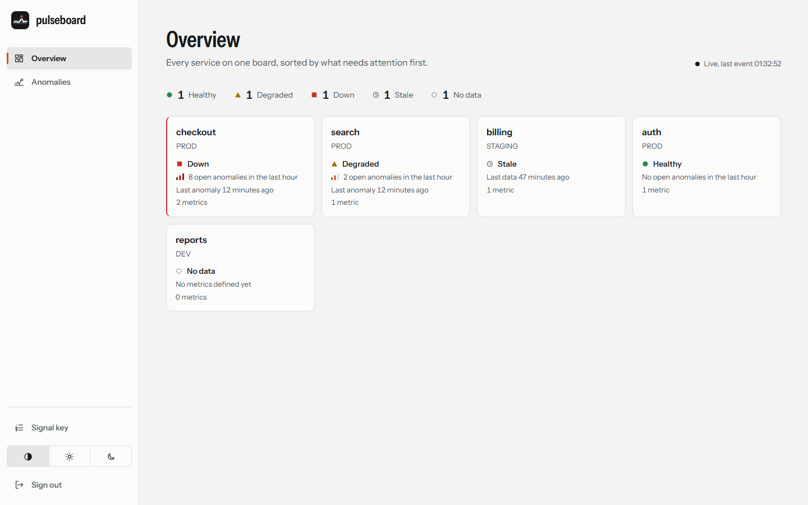
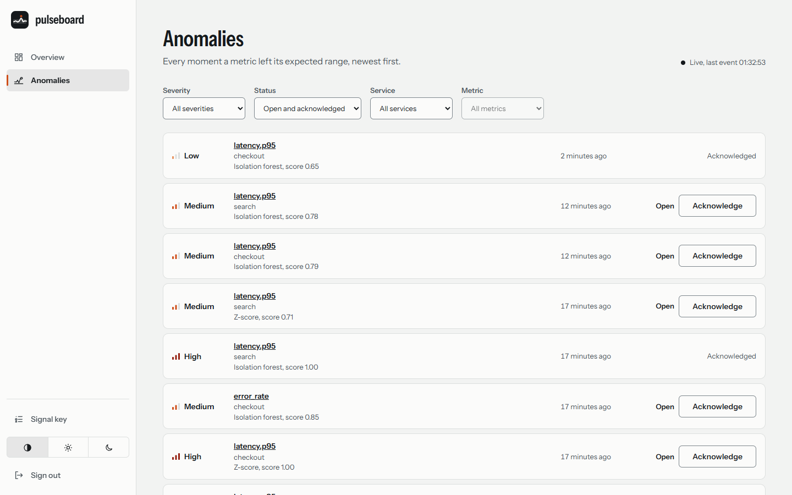
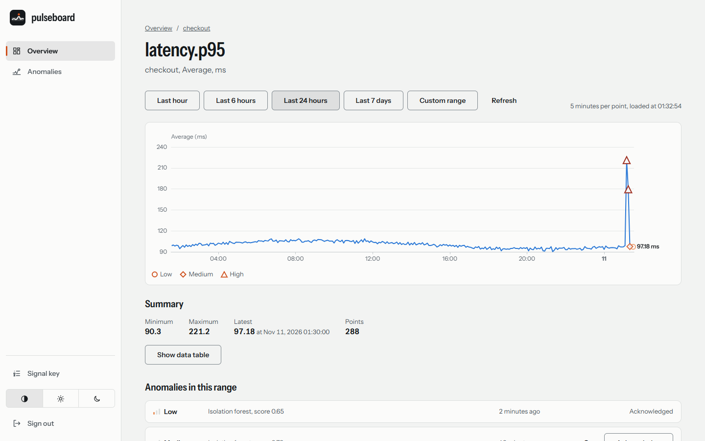
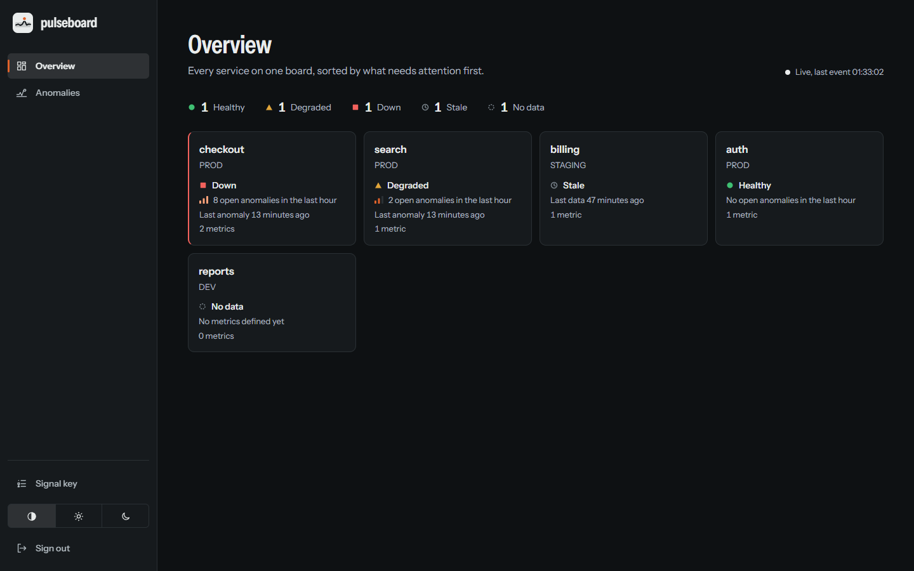
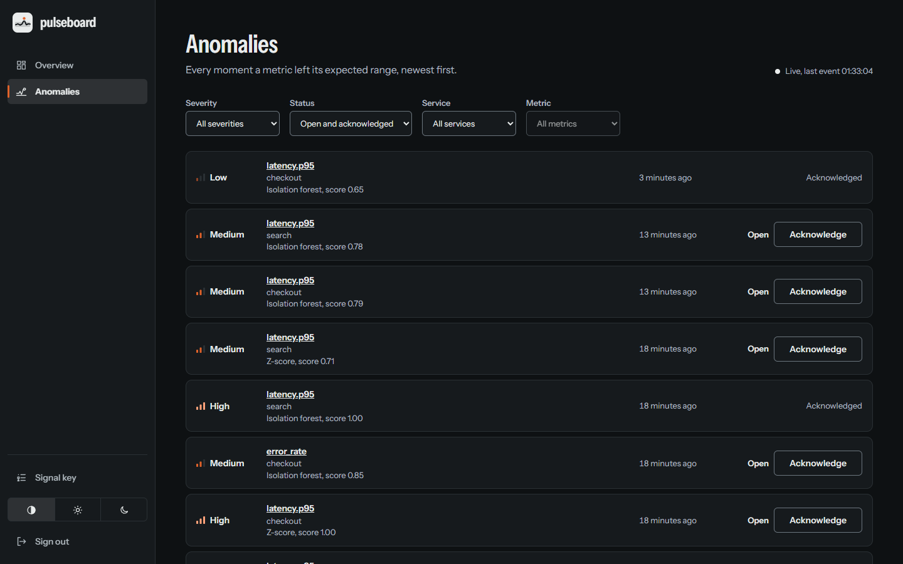
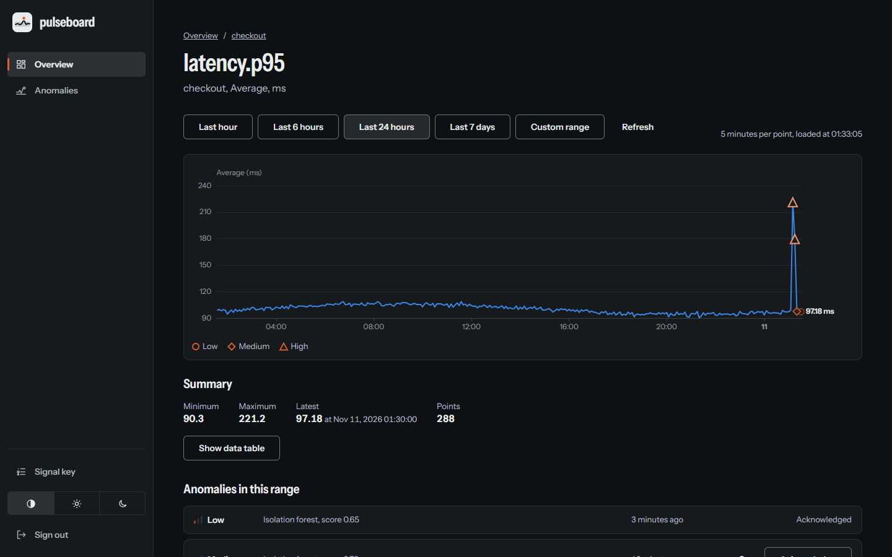

# Pulseboard Web

English | [Türkçe](README.tr.md)

Angular 22 single-page application for Pulseboard: standalone components, signals, zoneless change detection, strict TypeScript. It shows every service of a workspace as a health tile, lists anomalies live, charts a metric with anomaly markers and lets people acknowledge anomalies.

Visual identity, tokens, theming and screen layouts are documented in [DESIGN.md](DESIGN.md).

## Screenshots

Captured from the running stack with demo data. The app follows the system colour scheme and also has a manual switch.

| Overview | Anomalies | Metric |
|---|---|---|
|  |  |  |
|  |  |  |

More captures (mobile, sign in) are in the [root README](../../README.md#screenshots).

## Requirements

- Node.js 22.22.3+, 24.15+ or 26 (LTS; the container image uses 26)

## Scripts

| Command | Purpose |
|---|---|
| `npm start` | Dev server on `http://localhost:4200`; `/api` is proxied to `API_PROXY_TARGET` (default `http://localhost:8080`, see `proxy.conf.js`). |
| `npm run lint` | ESLint (angular-eslint, typescript-eslint, Prettier-compatible). |
| `npm test` | Jest via `@angular-builders/jest`. |
| `npm run build` | Production build into `dist/web/browser`. |
| `npm run format` / `npm run format:check` | Prettier write / check. |
| `npm run api:generate` | Rewrites `src/app/api/generated/schema.d.ts` from `contracts/api-core.openapi.yaml`. |
| `npm run api:check` | Fails when the checked-in schema differs from a fresh generation (CI drift check). |
| `npm run typecheck` | `tsc --noEmit` over the app and the specs (the Jest builder does not type check). |
| `node scripts/browser-audit.mjs` | axe-core scan (light and dark) of the pages of a running stack; `BASE` is its origin. Needs system Chrome. |

`scripts/browser-audit.mjs` also reads `VIEWPORT_WIDTH` (for example 390 for the narrow layout) and, when `SHOT_DIR` is set, writes a full-page screenshot per scan named `SHOT_PREFIX-scheme-page.png`.

## Structure

```text
src/app/
  api/        typed ApiClient over generated/schema.d.ts (read-only), problem+json decoding
  core/       session store, HTTP interceptors, guards, return URL rules, snackbar notifier
  features/   auth (login, register), overview, service-detail, metric-detail, anomalies, services store
  shell/      signed-in layout (rail, drawer, skip link)
  shared/     glyphs, icons, page head
```

Routes are lazy and standalone: `/login`, `/register`, `/app/overview`, `/app/services/:id`, `/app/metrics/:id`, `/app/anomalies`, and a not-found page for everything else.

## Live data and charts

- **Anomaly stream** (`features/anomalies/anomaly-stream.service.ts`). One `EventSource` per tab, held by the pages that show live data (`retain()`). Every connection attempt first asks `POST /api/v1/stream/ticket` for a one-time ticket, because a spent ticket cannot be reused; the browser's own auto-reconnect is never used (the source is closed on the first error). Failures back off 1, 2, 4 ... 30 s with equal jitter; a ticket answered with 429 waits for `Retry-After`; 403, or three 401 in a row, ends the retries ("Offline"). After every open the stores re-read `GET /api/v1/anomalies`, since missed events are not replayed. The source is closed on logout, when no page needs it, and 5 minutes after the tab was hidden (it reconnects when visible again).
- **Stores.** `AnomalyFeedStore` (filters, pages of 25, bounded at 500, dedupe by id, newest window first), `ServiceHealthStore` (unacknowledged anomalies of the last hour for the overview tiles, indexed by service id), `MetricsStore` (points and anomalies of one metric and range; the step is chosen so a query never exceeds 2000 buckets; a new range cancels the old request). They share `AnomalyBus`, through which stream events, optimistic acknowledgements and rollbacks reach every store. A REST answer never overwrites what is newer: each store keeps a bounded ledger of acknowledged ids (an id is never reopened by an older snapshot or a late open event; only a rollback lifts it) and buffers the live changes that arrive while a request is in flight, then applies them on top of the snapshot. The metric page reads the metric by id (`GET /api/v1/metrics/{id}`; the old `?service=` parameter is ignored), takes the names of anomalies from the anomalies themselves, honours both bounds of a custom range for live events and re-reads its anomalies after a reconnect. Chart rows for buckets the API omits are filled with nulls so gaps show as gaps.
- **Health on the overview** follows the product spec: no unacknowledged anomaly in the last hour is healthy (circle), LOW or MEDIUM is degraded (triangle), HIGH is down (square); a service with no metrics, or whose anomalies could not be read, shows "No data". A service whose newest sample (`lastPointAt`) is older than 15 minutes (`STALE_AFTER_MS`) and has no open anomaly is "Stale" (clock ring), never healthy; when more than 500 anomalies match the hour, services without a loaded anomaly show "No data" instead of healthy. A request that got a 401 is replayed after a refresh only while the session identity (logout, another sign-in) is unchanged; otherwise it fails with a cancelled error and is never sent with another person's token.
- **Chart.** ECharts is imported only by `metric-chart.component.ts` through a dynamic import (its own chunk, loaded on the metric page). `chart-options.ts` is a pure function from data and design tokens to the option; tokens are resolved in the browser (`chart-tokens.ts`) and the option is rebuilt when the theme or the motion preference changes. The chart is `role="img"` with a text summary, and the page repeats the numbers as text and as a table. No expected-range band is drawn: the API has none.

## Accessibility and Lighthouse

`node scripts/browser-audit.mjs` registers a throwaway workspace on a running stack, waits for the analytics service to produce anomalies and scans every page with axe-core in both colour schemes. Lighthouse CI is configured in `lighthouserc.json` (accessibility at least 0.9 on `/login` and `/register`): `npm run build && npx @lhci/cli autorun`.

## API client

`ApiClient` is a thin wrapper over `HttpClient`. Paths, path parameters, query, request and response bodies are typed from the OpenAPI contract, so `api.get('/api/v1/services/{serviceId}/metrics', { path: { serviceId } })` is checked by the compiler and a contract change that breaks a call fails the build. Never edit `src/app/api/generated`; change the contract and run `npm run api:generate`.

Errors reach callers as `ApiError` carrying a decoded `ApiProblem` (status, problem kind, field errors, Retry-After). User-facing text is composed from the status, never from the server's `detail` field.

## Session and security

- The **access token lives in memory only**. The **refresh token is kept in `sessionStorage`** so a reload does not sign the person out. Trade-off: any script running in the page (XSS) can read either token, with or without storage; sessionStorage additionally survives within the tab and is not shared with other tabs or sent anywhere automatically (unlike a cookie, it has no CSRF exposure). A strict CSP with no inline script (see `nginx/security-headers.conf`) is the main defence. If storage is blocked or full, the session silently stays in memory and a reload signs out. A duplicated tab copies sessionStorage, so two tabs may hold the same refresh token; the first to refresh wins and the server's reuse detection signs the other out.
- Concurrent 401s share **one** refresh (the server rotates the token on each use and revokes the whole family on reuse). Each request is replayed at most once; only a definite rejection (401/400) of the refresh ends the session, a network error or 5xx keeps it.
- The bearer is attached only to same-origin `/api/` requests, never to `/api/v1/auth/*`.
- `returnUrl` must be a path inside `/app`; anything else (`//host`, `https://host`, `/\host`, `javascript:`) is dropped.
- Logout clears memory, storage and every registered store, and tells the server (`POST /api/v1/auth/logout`), which revokes the whole refresh-token family. That call is best effort: if it fails, the person is still signed out locally and the token stays valid server-side until it expires or is rotated.
- The live anomaly stream is opened with a one-time `ticket` (`POST /api/v1/stream/ticket`, then `GET /api/v1/stream/anomalies?ticket=...`), because a browser `EventSource` cannot send an `Authorization` header. The bearer for the ticket request comes from `SessionStore.freshAccessToken()`.

## Container image

`Dockerfile` builds the app with `node:26.13.0-alpine` and serves it from `nginx:1.30.6-alpine`. `nginx.conf` provides SPA fallback to `index.html`, proxies `/api/` to `api-core:8080` (unbuffered and uncompressed for Server-Sent Events, access log without query strings so stream tickets are not stored), answers 404 for `/internal/`, sets the security headers and a Content-Security-Policy from `nginx/`, and exposes `GET /healthz` for container health checks.

An nginx error line repeats the request line and the upstream URL, query included. With the real nginx image and api-core refusing connections, a request to `/api/v1/stream/anomalies?ticket=...` logged both with the ticket. The stream location therefore uses `error_log ... crit`; the same test then left only the query-less access line. Trade-off: upstream connection errors of the stream (level error) are not logged any more; other `/api/` locations keep them.

```sh
docker build -t pulseboard-web .
```

The whole stack, including this image, is started from the repository root; see the [root README](../../README.md).
