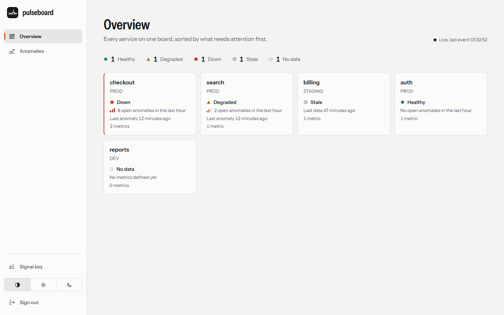
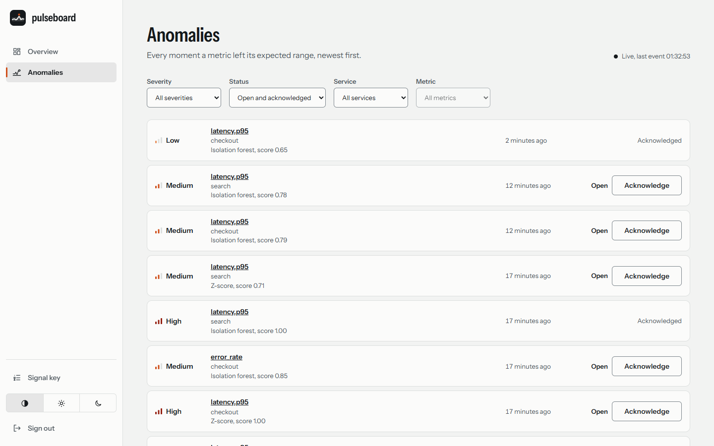
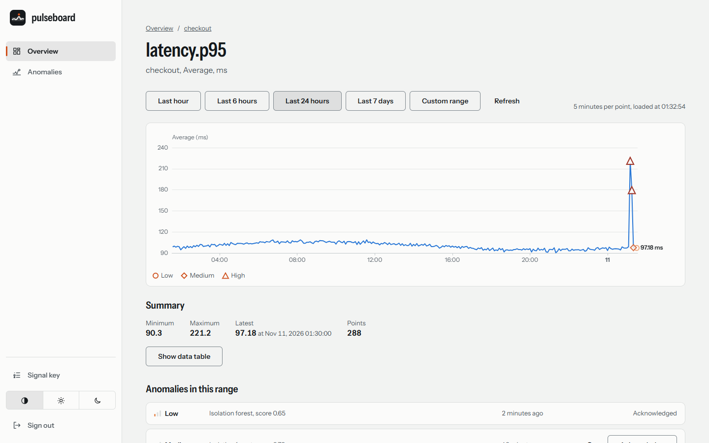
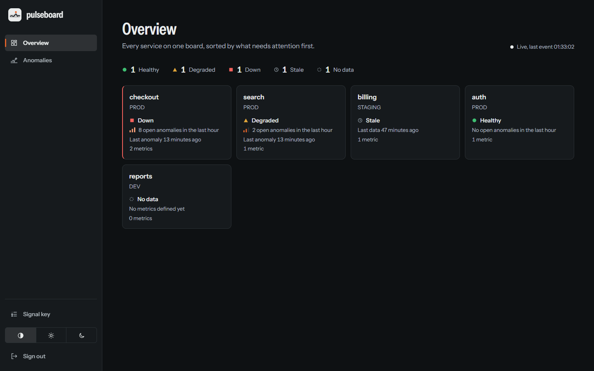
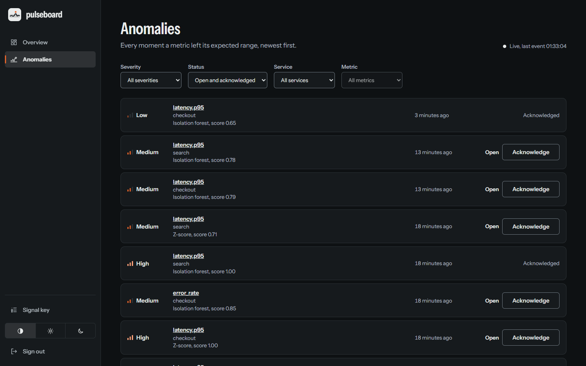
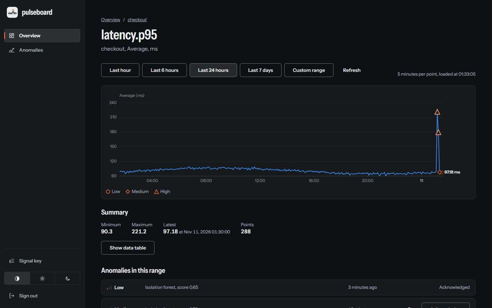

# Pulseboard Web

[English](README.md) | Türkçe

Pulseboard için Angular 22 tek sayfa uygulaması: standalone bileşenler, signal'ler, zoneless değişiklik algılama ve katı (strict) TypeScript. Bir çalışma alanındaki her servisi sağlık kutucuğu olarak gösterir, anomalileri canlı listeler, bir metriği anomali işaretleriyle çizer, anomalilerin onaylanmasını sağlar ve uyarı kurallarını teslim geçmişleriyle birlikte yönetir.

Görsel kimlik, tasarım token'ları, temalandırma ve ekran yerleşimleri [DESIGN.md](DESIGN.md) dosyasında belgelenmiştir (İngilizce).

## Ekran görüntüleri

Demo verisiyle çalışan ortamdan alınmıştır. Uygulama sistemin renk şemasını izler ve elle değiştirme anahtarı da vardır.

| Genel bakış                                                                               | Anomaliler                                                                                | Metrik                                                                                     |
| ----------------------------------------------------------------------------------------- | ----------------------------------------------------------------------------------------- | ------------------------------------------------------------------------------------------ |
|  |  |  |
|   |   |   |

Daha fazla görüntü (mobil, giriş) [kök README](../../README.tr.md#ekran-görüntüleri) içindedir.

## Gereksinimler

- Node.js 22.22.3+, 24.15+ veya 26 (LTS; konteyner imajı 26 kullanır)

## Komutlar

| Komut                                     | Amaç                                                                                                                                                                          |
| ----------------------------------------- | ----------------------------------------------------------------------------------------------------------------------------------------------------------------------------- |
| `npm start`                               | `http://localhost:4200` adresinde geliştirme sunucusu; `/api` istekleri `API_PROXY_TARGET` adresine yönlendirilir (varsayılan `http://localhost:8080`, bkz. `proxy.conf.js`). |
| `npm run lint`                            | ESLint (angular-eslint, typescript-eslint, Prettier uyumlu).                                                                                                                  |
| `npm test`                                | `@angular-builders/jest` ile Jest.                                                                                                                                            |
| `npm run build`                           | `dist/web/browser` dizinine üretim derlemesi.                                                                                                                                 |
| `npm run format` / `npm run format:check` | Prettier ile yazma / denetleme.                                                                                                                                               |
| `npm run api:generate`                    | `src/app/api/generated/schema.d.ts` dosyasını `contracts/api-core.openapi.yaml` içinden yeniden yazar.                                                                        |
| `npm run api:check`                       | Depodaki şema, yeni üretilenden farklıysa başarısız olur (CI sapma denetimi).                                                                                                 |
| `npm run typecheck`                       | Uygulama ve spec dosyaları üzerinde `tsc --noEmit` (Jest builder tip denetimi yapmaz).                                                                                        |
| `node scripts/browser-audit.mjs`          | Çalışan ortamın sayfalarında (uyarı sayfaları dahil) axe-core taraması (açık ve koyu tema); `BASE` ortamın adresidir. Sistemde Chrome gerekir.                                |

`scripts/browser-audit.mjs` ayrıca `VIEWPORT_WIDTH` değerini okur (dar yerleşim için örneğin 390). `SHOT_DIR` verilirse her tarama için `SHOT_PREFIX-scheme-page.png` adıyla tam sayfa ekran görüntüsü yazar.

## Yapı

```text
src/app/
  api/        generated/schema.d.ts üzerinde tiplenmiş ApiClient (salt okunur), problem+json çözümleme
  core/       oturum deposu, HTTP interceptor'lar, guard'lar, dönüş URL kuralları, snackbar bildirimcisi
  features/   auth (giriş, kayıt), overview, service-detail, metric-detail, anomalies, alerts (kurallar, düzenleyici, geçmiş), servis deposu
  shell/      oturum açıkken kullanılan yerleşim (rail, drawer, skip link)
  shared/     glifler, ikonlar, sayfa başlığı, onay penceresi
```

Rotalar tembel (lazy) ve standalone'dır: `/login`, `/register`, `/app/overview`, `/app/services/:id`, `/app/metrics/:id`, `/app/anomalies`, `/app/alerts` (kurallara yönlendirir), `/app/alerts/rules`, `/app/alerts/history`, `/app/alerts/rules/new`, `/app/alerts/rules/:id` ve diğer her şey için bir "bulunamadı" sayfası.

## Canlı veri ve grafikler

- **Anomali akışı** (`features/anomalies/anomaly-stream.service.ts`). Sekme başına bir `EventSource`; canlı veri gösteren sayfalar onu tutar (`retain()`). Harcanmış bir bilet yeniden kullanılamayacağından her bağlantı denemesi önce `POST /api/v1/stream/ticket` ile tek kullanımlık bir bilet ister; tarayıcının kendi otomatik yeniden bağlanması hiç kullanılmaz (ilk hatada kaynak kapatılır). Hatalarda bekleme 1, 2, 4 ... 30 sn olarak eşit jitter ile artar; 429 yanıtı alan bilet isteği `Retry-After` kadar bekler; 403 ya da art arda üç 401 yeniden denemeleri bitirir ("Offline"). Kaçırılan olaylar yeniden oynatılmadığı için her bağlantı açılışından sonra depolar `GET /api/v1/anomalies` çağrısını yeniden okur. Kaynak; çıkışta, hiçbir sayfa ona ihtiyaç duymadığında ve sekme gizlendikten 5 dakika sonra kapatılır (sekme yeniden görününce tekrar bağlanır).
- **Depolar.** `AnomalyFeedStore` (filtreler, 25'lik sayfalar, 500 ile sınırlı, kimliğe göre tekilleştirme, en yeni pencere önce), `ServiceHealthStore` (genel bakış kutucukları için son bir saatin onaylanmamış anomalileri, servis kimliğine göre indekslenmiş), `MetricsStore` (tek bir metriğin ve aralığın noktaları ile anomalileri; adım, bir sorgu hiçbir zaman 2000 kovayı aşmayacak şekilde seçilir; yeni bir aralık eski isteği iptal eder). Hepsi `AnomalyBus`'ı paylaşır; akış olayları, iyimser onaylar ve geri almalar bu yolla tüm depolara ulaşır. Bir REST yanıtı daha yeni olanın üzerine asla yazmaz: her depo, onaylanmış kimliklerden oluşan sınırlı bir defter tutar (bir kimlik, eski bir anlık görüntü ya da geç gelen bir "açıldı" olayıyla yeniden açılmaz; yalnızca geri alma bunu kaldırır) ve istek sürerken gelen canlı değişiklikleri tamponlayıp anlık görüntünün üzerine uygular. Metrik sayfası metriği kimliğiyle okur (`GET /api/v1/metrics/{id}`; eski `?service=` parametresi yok sayılır), anomali adlarını anomalilerin kendisinden alır, özel aralığın iki sınırını da canlı olaylar için dikkate alır ve yeniden bağlandıktan sonra anomalilerini yeniden okur. API'nin atladığı kovalar için grafik satırları null ile doldurulur; böylece boşluklar boşluk olarak görünür.
- **Genel bakıştaki sağlık** ürün şartnamesini izler: son bir saatte onaylanmamış anomali yoksa Healthy (daire), LOW veya MEDIUM varsa Degraded (üçgen), HIGH varsa Down (kare); metriği olmayan ya da anomalileri okunamayan servis "No data" gösterir. En yeni örneği (`lastPointAt`) 15 dakikadan eski olan ve açık anomalisi bulunmayan servis "Stale" (saat halkası) olur, asla healthy görünmez; o saate uyan anomali sayısı 500'ü aşarsa, yüklenmiş anomalisi olmayan servisler healthy yerine "No data" gösterir. 401 alan bir istek, yalnızca oturum kimliği (çıkış, başka bir giriş) değişmemişse yenilemeden sonra yeniden gönderilir; aksi halde iptal hatasıyla biter ve başka birinin token'ı ile asla gönderilmez.
- **Grafik.** ECharts yalnızca `metric-chart.component.ts` tarafından dinamik import ile yüklenir (kendi parçası, metrik sayfasında yüklenir). `chart-options.ts`, veri ve tasarım token'larından grafik seçeneğini üreten saf bir fonksiyondur; token'lar tarayıcıda çözülür (`chart-tokens.ts`) ve tema veya hareket tercihi değiştiğinde seçenek yeniden kurulur. Grafik `role="img"` ve metin özeti taşır; sayfa değerleri ayrıca metin ve tablo olarak tekrar eder. Beklenen aralık bandı çizilmez: API böyle bir veri sunmaz.

## Uyarılar

`AlertRulesStore` ve `AlertHistoryStore` (`features/alerts` içinde) diğer depoları izler: yükleniyor, hata ve boş durumları, istek başına switchMap, çıkıştan sonra gelen yanıtları atan bir epoch ve `SessionLifecycle` ile sıfırlama.

- **Kurallar** (`/app/alerts/rules`). Sahipler ve yöneticiler kural oluşturabilir, düzenleyebilir, silebilir ve açıp kapatabilir; diğer roller açıklamalı salt okunur bir liste görür ve bu kontroller hiç üretilmez. Açıp kapatma ve silme iyimser (optimistic) çalışır, sunucu reddederse geri alınır. Her değişiklik, başladığı `version` değerini taşır. Sürüm çakışması (veya kaybolmuş bir kural) hiçbir şeyin üzerine yazmaz: liste olduğu gibi kalır ve bir bildirim yeniden yüklemeyi önerir; düzenleyici yapılan değişiklikleri ekranda tutar ve en son sürümü yüklemeyi önerir (bu, değişiklikleri atar). Bir değişiklik bitmeden önce istenmiş bir liste yanıtı atılır ve yeniden istenir. Kural sınırı (`alert-rule-limit`) ve kullanılmış ad (`conflict`) kendi iletilerine sahiptir. Webhook kurallarının hedefi listelerde yalnızca ana makine adı olarak gösterilir.
- **Düzenleyici** (`/app/alerts/rules/new`, `/:id`). Tipli reactive form (doğrulayıcılar, dinamik alanlar ve istek oluşturucular `alert-rule-form.ts` içinde düz fonksiyonlardır). Eşik kuralı operatörü ve metriğin birimiyle değeri gösterir; anomali kuralı önem glifleriyle en düşük önem düzeyini gösterir. Seçilmeyen koşulun alanları gizlenmez, kaldırılır ve nazik bir durum satırı neyin göründüğünü bildirir; kanalı değiştirmek hedefi temizler. Webhook adresi tarayıcıda yalnızca ipucu olarak denetlenir (https, kullanıcı bilgisi yok, IP adresi yok, localhost veya iç ağ adı yok); karar sunucunundur ve sunucunun alan iletileri (`errors[]`, JSON pointer veya bean yolu) kontrole yerleştirilip `aria-describedby` ile bağlanır. Adres yalnızca formda yaşar: asla saklanmaz veya günlüğe yazılmaz. Değişiklik içeren bir formdan ayrılmadan önce sorulur (`canDeactivate`).
- **Geçmiş** (`/app/alerts/history`). Sunucu tarafında sayfalama (sayfada 25), kural, durum ve tarih aralığı filtreleri (yerel günler; bitiş günü dahildir), en yeni önce. Durum glif ve sözcüktür (bekliyor, gönderildi, başarısız; sinyal anahtarında listelenir). "Details" düğmesi, yükü düzenli yazılmış metin olarak yana kayan bir `<pre>` içinde ve kopyalama düğmesiyle gösteren bir pencere açar; sunucudan gelen her şey, son hata dahil, yalnızca metin olarak yazılır. Bir şey beklemedeyken ve sekme görünürken liste 30 saniyede bir kendini yeniler; aksi halde hiçbir şey sorgulanmaz. `/app/alerts/history?ruleId=...` tek bir kuralın geçmişini açar (kurallar listesi buraya bağlanır).
- Sunucu WEBHOOK kurallarını yalnızca `ALERT_WEBHOOK_SIGNING_SECRET` tanımlıyken kabul eder; tanımsızsa böyle bir kuralı kaydetmek kanal alanında bir iletiyle reddedilir. EMAIL_LOG kanalı kurulum gerektirmez (uyarı api-core günlüğüne yazılır).

## Erişilebilirlik ve Lighthouse

`node scripts/browser-audit.mjs`, çalışan ortamda geçici bir çalışma alanı kaydeder, iki uyarı kuralı oluşturur, analytics servisinin anomali üretmesini ve ilk uyarının teslim edilmesini bekler ve her sayfayı (uyarı sayfaları, iki koşul için kural düzenleyici, silme onayı ve olay penceresi dahil) iki renk şemasında axe-core ile tarar. Lighthouse CI `lighthouserc.json` içinde yapılandırılmıştır (`/login` ve `/register` için erişilebilirlik en az 0,9): `npm run build && npx @lhci/cli autorun`.

## API istemcisi

`ApiClient`, `HttpClient` üzerinde ince bir sarmalayıcıdır. Yollar, yol parametreleri, sorgu, istek ve yanıt gövdeleri OpenAPI sözleşmesinden tiplenir; bu yüzden `api.get('/api/v1/services/{serviceId}/metrics', { path: { serviceId } })` derleyici tarafından denetlenir ve bir çağrıyı bozan sözleşme değişikliği derlemeyi başarısız kılar. `src/app/api/generated` dizinini asla elle düzenlemeyin; sözleşmeyi değiştirin ve `npm run api:generate` çalıştırın.

Hatalar çağıranlara, çözülmüş bir `ApiProblem` (durum, problem türü, alan hataları, Retry-After) taşıyan `ApiError` olarak ulaşır. Kullanıcıya gösterilen metin duruma göre oluşturulur, sunucunun `detail` alanından asla alınmaz.

## Oturum ve güvenlik

- **Access token yalnızca bellekte tutulur.** **Refresh token `sessionStorage` içinde tutulur**; böylece sayfa yenilemek kişiyi oturumdan çıkarmaz. Ödünleşim: sayfada çalışan herhangi bir script (XSS), depolama olsun ya da olmasın iki token'ı da okuyabilir; sessionStorage ayrıca sekme içinde kalıcıdır, diğer sekmelerle paylaşılmaz ve kendiliğinden hiçbir yere gönderilmez (çerezin aksine CSRF riski yoktur). Ana savunma, satır içi script içermeyen sıkı bir CSP'dir (bkz. `nginx/security-headers.conf`). Depolama engellenmiş ya da doluysa oturum sessizce bellekte kalır ve sayfa yenilenince çıkış yapılmış olur. Çoğaltılan bir sekme sessionStorage'ı kopyalar, dolayısıyla iki sekme aynı refresh token'a sahip olabilir; ilk yenileyen kazanır, sunucunun yeniden kullanım tespiti diğerinin oturumunu kapatır.
- Eşzamanlı 401'ler **tek** bir yenilemeyi paylaşır (sunucu token'ı her kullanımda döndürür ve yeniden kullanımda tüm aileyi iptal eder). Her istek en fazla bir kez yeniden gönderilir; oturumu yalnızca yenilemenin kesin reddi (401/400) bitirir, ağ hatası veya 5xx bitirmez.
- Bearer yalnızca aynı kaynaktaki `/api/` isteklerine eklenir, `/api/v1/auth/*` isteklerine asla eklenmez.
- `returnUrl`, `/app` içinde bir yol olmalıdır; başka her şey (`//host`, `https://host`, `/\host`, `javascript:`) atılır.
- Çıkış; belleği, depolamayı ve kayıtlı her depoyu temizler ve sunucuya da bildirir (`POST /api/v1/auth/logout`); sunucu tüm refresh token ailesini iptal eder. Bu çağrı en iyi çaba esaslıdır: başarısız olursa kişi yine de yerel olarak çıkış yapmış olur ve token, süresi dolana ya da döndürülene kadar sunucuda geçerli kalır.
- Canlı anomali akışı, tek kullanımlık bir `ticket` ile açılır (`POST /api/v1/stream/ticket`, ardından `GET /api/v1/stream/anomalies?ticket=...`); çünkü tarayıcının `EventSource` nesnesi `Authorization` başlığı gönderemez. Bilet isteğinin bearer'ı `SessionStore.freshAccessToken()` üzerinden gelir.

## Konteyner imajı

`Dockerfile`, uygulamayı `node:26.13.0-alpine` ile derler ve `nginx:1.30.6-alpine` üzerinden sunar. `nginx.conf` şunları sağlar: `index.html`'e SPA yedeği, `/api/` isteklerinin `api-core:8080` adresine yönlendirilmesi (Server-Sent Events için tamponsuz ve sıkıştırmasız; bilet saklanmasın diye sorgu dizesiz erişim günlüğü), `/internal/` için 404, `nginx/` içindeki güvenlik başlıkları ve Content-Security-Policy ile konteyner sağlık denetimi için `GET /healthz`.

Bir nginx hata satırı, sorgu dahil istek satırını ve upstream URL'sini tekrar eder. Gerçek nginx imajı ve bağlantıyı reddeden api-core ile yapılan denemede `/api/v1/stream/anomalies?ticket=...` isteği, ikisini de bilet ile birlikte günlüğe yazdı. Bu yüzden akış konumu `error_log ... crit` kullanır; aynı deneme bundan sonra yalnızca sorgusuz erişim satırını bıraktı. Ödünleşim: akışın upstream bağlantı hataları (error seviyesi) artık günlüğe yazılmaz; diğer `/api/` konumları yazmaya devam eder.

```sh
docker build -t pulseboard-web .
```

İmaj dahil tüm ortam depo kök dizininden başlatılır; bkz. [kök README](../../README.tr.md).
