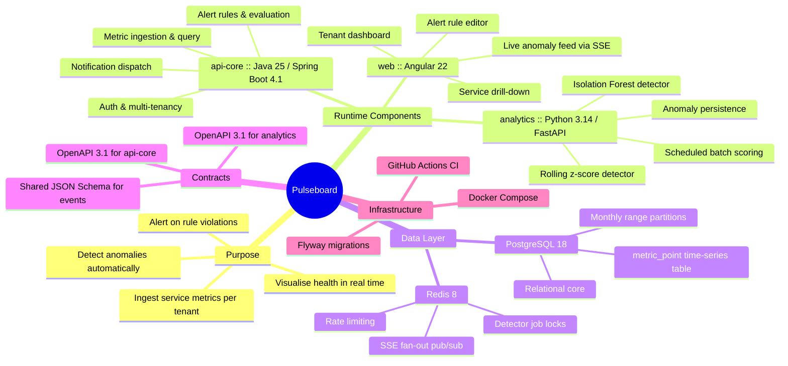
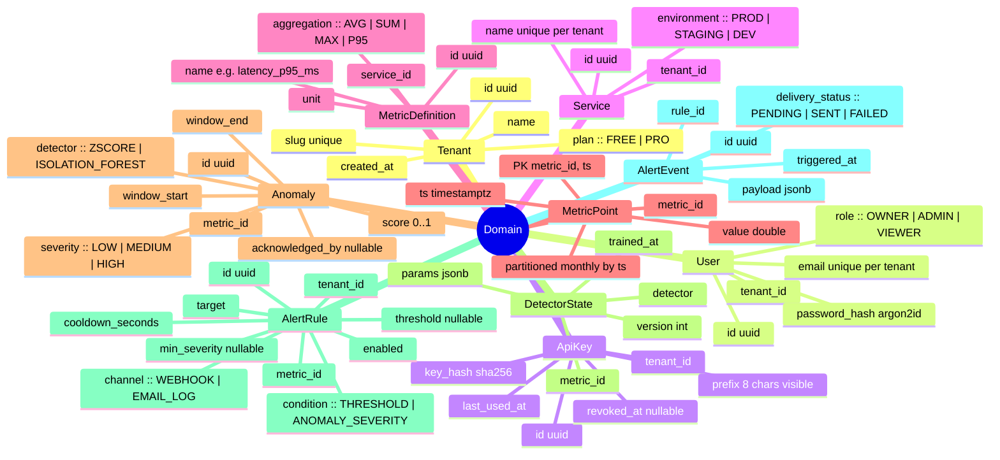
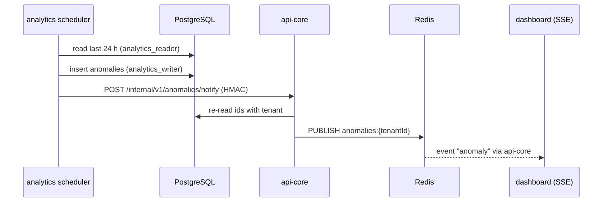

# Pulseboard Architecture

## 1. System Overview Mind Map



## 2. Architecture

### 2.1 Repository layout

```text
pulseboard/
├── apps/
│   ├── api-core/            # Spring Boot (Gradle Kotlin DSL)
│   └── web/                 # Angular 22 workspace
├── services/
│   └── analytics/           # FastAPI + scikit-learn
├── contracts/
│   ├── api-core.openapi.yaml
│   ├── analytics.openapi.yaml
│   └── events/
│       ├── metric-batch.schema.json
│       └── anomaly-detected.schema.json
├── infra/
│   ├── docker-compose.yml
│   ├── docker-compose.dev.yml
│   └── postgres/init/
├── .github/workflows/
│   ├── api-core.yml
│   ├── analytics.yml
│   └── web.yml
├── docs/
│   ├── ARCHITECTURE.md
│   └── ADR/
├── Makefile
└── README.md
```

### 2.2 Component responsibilities

| Component | Owns | Never does |
|---|---|---|
| `api-core` | Identity, tenancy, ingestion, metric queries, alert rules, alert evaluation, notification dispatch, SSE endpoint | Statistical modelling |
| `analytics` | Detector algorithms, scoring jobs, anomaly writes, model parameter persistence | Auth, tenancy decisions, HTTP-facing business rules |
| `web` | All UI, client-side state, charting | Direct DB access, business validation beyond UX hints |

### 2.3 Inter-service contracts

- `web → api-core`: REST (JWT bearer) + SSE (`/api/v1/stream/anomalies`).
- `api-core → analytics`: REST. `api-core` is the only caller of `analytics`. `analytics` is not exposed outside the Docker network.
- `analytics → PostgreSQL`: read-only role `analytics_reader` for `metric_point`; write role `analytics_writer` limited to `anomaly` and `detector_state`.
- `analytics → api-core`: after scoring, `POST /internal/v1/anomalies/notify` with a shared HMAC-signed body so `api-core` can push SSE and evaluate alert rules. Internal endpoints are guarded by `X-Internal-Signature` (HMAC-SHA256 over the raw body using `INTERNAL_SHARED_SECRET`).

### 2.4 Technology decisions

#### api-core

- Java 25, Spring Boot 4.1.x, Gradle Kotlin DSL, Spring Web MVC (not WebFlux), Spring Security with JWT (Nimbus JOSE), Spring Data JPA + Hibernate 7, Flyway, Bean Validation, springdoc-openapi, Micrometer + Prometheus registry, Testcontainers (PostgreSQL, Redis), ArchUnit for layering rules, MapStruct for DTO mapping.
- Package root: `io.pulseboard.core`. Layering: `api` → `application` → `domain` ← `infrastructure`. `domain` has no Spring dependencies.
- Sessions: a login creates a refresh-token family. Each refresh rotates the token inside the family and reuse of a rotated token revokes the family. A family also ends at an absolute lifetime counted from login (`REFRESH_FAMILY_TTL`, default 30 days): rotation never extends a token past it, and a refresh after it answers 401 and revokes the family.
- `POST /api/v1/auth/logout` takes the refresh token, needs no valid access token and revokes its whole family. It is idempotent: an unknown or already revoked token is answered with the same 204. It shares the per-client rate limit of the other auth endpoints.

#### analytics

- Python 3.14, FastAPI, Pydantic v2, SQLAlchemy 2 (sync, psycopg 3), with schema owned by Flyway in `api-core`; analytics reads and writes existing tables without Alembic. APScheduler for jobs, numpy, pandas, scikit-learn, httpx, structlog. Package manager: `uv`. Lint and format: `ruff`. Types: `mypy --strict`. Tests: `pytest` + `testcontainers[postgres]`.
- Package root: `pulseboard_analytics`.

#### web

- Angular 22 (standalone components, signals, `inject()`), Angular Router with lazy routes, `@ngrx/signals` for stores, Angular Material, `ngx-echarts`, `date-fns`. Strict TypeScript, ESLint (angular-eslint), Prettier, Jest via `@angular-builders/jest`. No NgModules. No `any`.

## 3. Domain Model Mind Map



**Multi-tenancy rule:** Every tenant-scoped table has `tenant_id` directly or through a `service_id` join. `api-core` enforces tenancy with a `TenantContext` resolved from the JWT or API key on every request. Repositories do not accept unscoped queries for tenant-owned aggregates. An ArchUnit test fails if any `*Repository` method for tenant-scoped entities lacks `tenantId` in its signature.

## 4. Key Flows

### 4.1 Ingestion

1. An agent sends `POST /api/v1/ingest` with `X-Api-Key`. The body conforms to `contracts/events/metric-batch.schema.json` and contains at most 1,000 points per batch.
2. `api-core` validates the key (hash lookup, Redis-cached for 60 seconds), rate-limits per tenant using a Redis token bucket (FREE: 60 batches/minute; PRO: 600), validates the schema, then bulk-inserts with JDBC batch using `JdbcTemplate.batchUpdate` and `ON CONFLICT (metric_id, ts) DO UPDATE`.
3. The response is `202 Accepted` with `{ "accepted": n, "rejected": [...] }`.

### 4.2 Detection

1. APScheduler (in the `analytics` process, every 60 seconds) runs `score_all_metrics`. A Redis lock (`SET NX PX 55000`, owner token, compare-and-delete release) makes sure only one run is active; a run that finds the lock held is skipped.
   The lease bounds the work of a run but is not exclusive: if a run overruns it, a second one may start. The single writer guarantee comes from the idempotent inserts, not from the lock. When a run stops at `SCORE_DEADLINE_SECONDS`, the Redis key `analytics:score_all:cursor` remembers where it stopped, so the next run continues after that metric and every metric gets its turn (fair rotation).
2. Metrics with at least one point in the last 24 hours are selected through the read-only role. For each one the last 24 hours are loaded and both detectors run. There is no cursor: every run re-scores the whole window, so late points are picked up automatically. A failure for one metric does not stop the others.
3. Anomalies are written with the `analytics_writer` role using `INSERT ... ON CONFLICT (metric_id, detector, window_start, window_end) DO NOTHING RETURNING`. Only rows that were actually inserted are reported, so re-scoring the same window never produces duplicates or repeated notifications. `DetectorState` is upserted.
4. The inserted anomalies are posted to `POST /internal/v1/anomalies/notify` in batches of at most 500, HMAC-signed, with three attempts and exponential backoff on network errors, 5xx and 429. A failed notification is logged and does not undo the stored anomalies; they stay visible through `GET /api/v1/anomalies`.
5. `api-core` re-reads each announced id from the database and publishes what the database holds to the Redis channel `anomalies:{tenantId}`. Every `api-core` instance with a stream open for that tenant forwards the message to its SSE clients.



### 4.3 Alerting

- Alert evaluation is an application service in `api-core` triggered by ingestion for `THRESHOLD` rules and by internal anomaly notifications for `ANOMALY_SEVERITY` rules.
- Cooldown is enforced via Redis key `alert:cooldown:{ruleId}` with a TTL.
- `WEBHOOK` delivery uses HTTP POST with `RestClient`, a 5-second timeout, and three retries; the outcome is persisted on `AlertEvent`. `EMAIL_LOG` writes a structured log line; real SMTP is out of scope.

### 4.4 Detector specifications

#### Rolling z-score

- Window: 288 points (24 hours at 5-minute resolution), or all available points if fewer; minimum 30 points.
- `score = min(1, |z| / 6)`; an anomaly is detected when `|z| >= 3`. Severity: `3 <= |z| < 4` LOW, `4 <= |z| < 5` MEDIUM, `|z| >= 5` HIGH.
- Constant series (`std = 0`) return no anomalies.

#### Isolation Forest

- Features per point: `value`, `diff_1`, `rolling_mean_12`, `rolling_std_12`, `hour_of_day_sin`, `hour_of_day_cos`.
- `n_estimators=200`, `contamination=0.02`, `random_state=42`. Retrain per metric every 6 hours or when point count grows by at least 20%; persist `trained_at`, `version`, and the fitted contamination in `DetectorState.params`.
- `score = 1 - normalised decision_function`; an anomaly is detected when `score >= 0.65`. Severity is assigned by tertiles of `[0.65, 1.0]`.

Both detectors are pure functions over a `pandas.DataFrame` with a documented input schema. Unit tests use synthetic series with injected spikes, level shifts, and seasonal baselines.

### 4.5 Internal endpoints and the anomaly stream

#### Internal HMAC contract

- Scope: `POST /internal/v1/anomalies/notify` on `api-core` (caller: `analytics`) and `POST /internal/v1/score` on `analytics`. Both sit on their own security chain; a JWT or an API key never authenticates them.
- Header `X-Internal-Signature`: lowercase hex HMAC-SHA256 over the raw request body bytes, keyed with `INTERNAL_SHARED_SECRET`. The comparison is constant time. A missing, malformed or wrong signature is answered with 401.
- Both services refuse to start when the secret is empty or shorter than 32 characters. The body size limit (`INTERNAL_MAX_BODY_BYTES`, default 512 KiB, 4 KiB on `analytics`) is enforced before the body is hashed. The secret and the signatures are never logged.
- The signature covers the body only, there is no timestamp. This is acceptable because `notify` is idempotent: `api-core` ignores the tenant, metric and severity sent in the body, re-reads each id (with its tenant) from the database and publishes only what the database says. Unknown ids, or ids of another tenant, are counted in `unknown`. Nothing is inserted, so a replayed request only repeats a publish.
- `/internal/` must never be exposed by the public reverse proxy. Inside the Docker network only `analytics` talks to it.

#### Server-sent events

`GET /api/v1/stream/anomalies` (JWT bearer header or a one-time `ticket`, tenant taken from the token only) sends an `anomaly` event per new anomaly with the anomaly id as the event id and the anomaly JSON as data, plus a `: ping` comment every 30 seconds. Limits: 10 streams per tenant (`ANOMALY_STREAM_MAX_PER_TENANT`) and 500 per instance (429 above), 30 minutes maximum lifetime or token expiry, whichever comes first. Events are not replayed after a reconnect; clients read `GET /api/v1/anomalies` to catch up.

#### One-time stream ticket

A browser `EventSource` cannot send an `Authorization` header, so the client first calls `POST /api/v1/stream/ticket` (bearer authenticated, 30 per minute per user) and opens `GET /api/v1/stream/anomalies?ticket=...` with the result.

- A ticket is 32 random bytes (base64url), valid for 30 seconds (`STREAM_TICKET_TTL`, never longer than the remaining life of the access token) and single use: it is consumed atomically (`GETDEL`) on the first request, also when that request is refused by a stream cap.
- Only the SHA-256 hash is stored in Redis (`stream:ticket:{hash}`, value: tenant, user, token expiry). The plain ticket exists only in the response and in the one stream request. The stream ends at the stored token expiry, exactly as with a bearer header.
- Every failure (unknown, expired, used, malformed, combined with other credentials) gets the same 401 body. Redis being unavailable gives 503.
- The ticket is a credential in a URL, so it must not reach logs. `api-core` masks `ticket=` and `access_token=` values in all log messages (exception stack traces are not rewritten). The reverse proxy must keep `access_log off` or log `$uri` instead of `$request_uri`.

A reverse proxy in front of this endpoint must:

- use HTTP/1.1 to the upstream and keep the connection open (`proxy_http_version 1.1`, `Connection ""`);
- disable buffering (`proxy_buffering off`, optionally `X-Accel-Buffering: no` upstream);
- allow idle connections longer than the heartbeat (`proxy_read_timeout` of at least 60 s, 1 h is fine);
- not compress `text/event-stream` (`gzip off` for this location);
- forward the `Authorization` header and the query string (the `ticket` parameter).

The end-to-end test talks to `api-core` directly. See `apps/web/nginx.conf` for the proxy configuration.

#### Scheduling details worth knowing

- A metric whose scoring exhausts the run budget is recorded in the Redis hash `analytics:score_all:slow` (id to failures and next retry time; exponential backoff starting at 120 s, capped at 3600 s, at most 500 entries, 24 hour TTL). While backing off it is skipped; once due it runs after all other metrics, and a success removes the entry.
- Notifications reach subscribers in publish order per tenant: `api-core` delivers them to the stream through a single-threaded dispatcher, so one slow tenant cannot reorder another tenant's events or its own.
- At startup `analytics` checks its database roles (`VERIFY_DB_ROLES`): no CREATE and required USAGE on schema `public`, nothing on other schemas, no reachable role with superuser, CREATEROLE, CREATEDB, REPLICATION or BYPASSRLS. `infra/postgres/init` creates the roles accordingly (`REVOKE ALL ON SCHEMA public FROM PUBLIC`, then explicit grants). The init scripts run only on an empty data volume, so changing them does not affect an existing dev volume; recreate it with `docker compose down -v`.

### 4.6 End-to-end check

`make e2e` (`scripts/e2e/run.py`, Python standard library only) starts postgres, redis, `api-core` and `analytics` as the throwaway compose project `pulseboard-e2e` with generated secrets, ingests a noisy series with a spike, waits (at most 180 s) for the scheduler, and asserts the anomaly in REST and SSE, tenant isolation and the internal HMAC behaviour. The project is always removed afterwards; `make e2e-down` cleans up after an interrupted run. In CI it runs as the separate workflow `.github/workflows/e2e.yml` (nightly schedule and manual dispatch only, 20 minute timeout), not on push or pull request. `make check-compose` (`scripts/check_compose_env.py`) verifies that `docker compose config` passes the analytics and stream settings.
