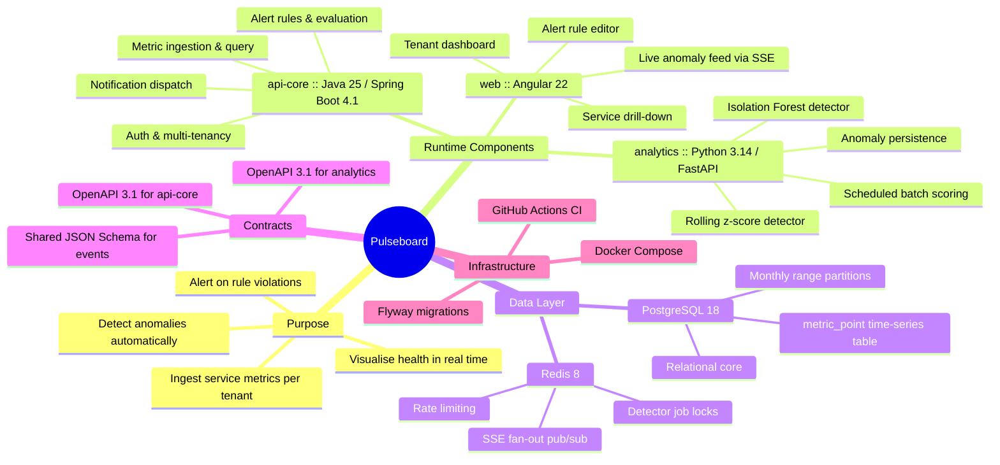
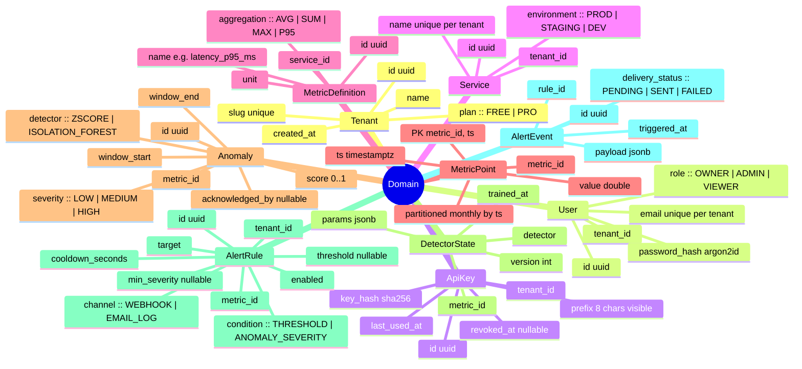

# Pulseboard Architecture

## 1. System Overview Mind Map



## 2. Architecture

### 2.1 Repository layout

```text
pulseboard/
├── apps/
│   ├── api-core/            # Spring Boot (Gradle Kotlin DSL)
│   └── web/                 # Angular 22 workspace
├── services/
│   └── analytics/           # FastAPI + scikit-learn
├── contracts/
│   ├── api-core.openapi.yaml
│   ├── analytics.openapi.yaml
│   └── events/
│       ├── metric-batch.schema.json
│       └── anomaly-detected.schema.json
├── infra/
│   ├── docker-compose.yml
│   ├── docker-compose.dev.yml
│   └── postgres/init/
├── .github/workflows/
│   ├── api-core.yml
│   ├── analytics.yml
│   └── web.yml
├── docs/
│   ├── ARCHITECTURE.md
│   └── ADR/
├── Makefile
└── README.md
```

### 2.2 Component responsibilities

| Component | Owns | Never does |
|---|---|---|
| `api-core` | Identity, tenancy, ingestion, metric queries, alert rules, alert evaluation, notification dispatch, SSE endpoint | Statistical modelling |
| `analytics` | Detector algorithms, scoring jobs, anomaly writes, model parameter persistence | Auth, tenancy decisions, HTTP-facing business rules |
| `web` | All UI, client-side state, charting | Direct DB access, business validation beyond UX hints |

### 2.3 Inter-service contracts

- `web → api-core`: REST (JWT bearer) + SSE (`/api/v1/stream/anomalies`).
- `api-core → analytics`: REST. `api-core` is the only caller of `analytics`. `analytics` is not exposed outside the Docker network.
- `analytics → PostgreSQL`: read-only role `analytics_reader` for `metric_point`; write role `analytics_writer` limited to `anomaly` and `detector_state`.
- `analytics → api-core`: after scoring, `POST /internal/v1/anomalies/notify` with a shared HMAC-signed body so `api-core` can push SSE and evaluate alert rules. Internal endpoints are guarded by `X-Internal-Signature` (HMAC-SHA256 over the raw body using `INTERNAL_SHARED_SECRET`).

### 2.4 Technology decisions

#### api-core

- Java 25, Spring Boot 4.1.x, Gradle Kotlin DSL, Spring Web MVC (not WebFlux), Spring Security with JWT (Nimbus JOSE), Spring Data JPA + Hibernate 7, Flyway, Bean Validation, springdoc-openapi, Micrometer + Prometheus registry, Testcontainers (PostgreSQL, Redis), ArchUnit for layering rules, MapStruct for DTO mapping.
- Package root: `io.pulseboard.core`. Layering: `api` → `application` → `domain` ← `infrastructure`. `domain` has no Spring dependencies.

#### analytics

- Python 3.14, FastAPI, Pydantic v2, SQLAlchemy 2 (sync, psycopg 3), with schema owned by Flyway in `api-core`; analytics reads and writes existing tables without Alembic. APScheduler for jobs, numpy, pandas, scikit-learn, httpx, structlog. Package manager: `uv`. Lint and format: `ruff`. Types: `mypy --strict`. Tests: `pytest` + `testcontainers[postgres]`.
- Package root: `pulseboard_analytics`.

#### web

- Angular 22 (standalone components, signals, `inject()`), Angular Router with lazy routes, `@ngrx/signals` for stores, Angular Material, `ngx-echarts`, `date-fns`. Strict TypeScript, ESLint (angular-eslint), Prettier, Jest via `@angular-builders/jest`. No NgModules. No `any`.

## 3. Domain Model Mind Map



**Multi-tenancy rule:** Every tenant-scoped table has `tenant_id` directly or through a `service_id` join. `api-core` enforces tenancy with a `TenantContext` resolved from the JWT or API key on every request. Repositories do not accept unscoped queries for tenant-owned aggregates. An ArchUnit test fails if any `*Repository` method for tenant-scoped entities lacks `tenantId` in its signature.

## 4. Key Flows

### 4.1 Ingestion

1. An agent sends `POST /api/v1/ingest` with `X-Api-Key`. The body conforms to `contracts/events/metric-batch.schema.json` and contains at most 1,000 points per batch.
2. `api-core` validates the key (hash lookup, Redis-cached for 60 seconds), rate-limits per tenant using a Redis token bucket (FREE: 60 batches/minute; PRO: 600), validates the schema, then bulk-inserts with JDBC batch using `JdbcTemplate.batchUpdate` and `ON CONFLICT (metric_id, ts) DO UPDATE`.
3. The response is `202 Accepted` with `{ "accepted": n, "rejected": [...] }`.

### 4.2 Detection

1. APScheduler in `analytics` runs `score_all_metrics` every 60 seconds. A Redis lock (`SET NX PX 55000`) guarantees single execution.
2. For each metric with points in the last 24 hours, the service loads the window, runs both detectors, writes `Anomaly` rows for windows scoring above threshold, and upserts `DetectorState`.
3. New anomalies are posted to the `api-core` internal endpoint in batches, HMAC-signed, with three retries using exponential backoff.
4. `api-core` publishes to Redis channel `anomalies:{tenantId}`. The SSE controller fans out to connected dashboards, and the alert engine evaluates `ANOMALY_SEVERITY` rules.

### 4.3 Alerting

- Alert evaluation is an application service in `api-core` triggered by ingestion for `THRESHOLD` rules and by internal anomaly notifications for `ANOMALY_SEVERITY` rules.
- Cooldown is enforced via Redis key `alert:cooldown:{ruleId}` with a TTL.
- `WEBHOOK` delivery uses HTTP POST with `RestClient`, a 5-second timeout, and three retries; the outcome is persisted on `AlertEvent`. `EMAIL_LOG` writes a structured log line; real SMTP is out of scope.

### 4.4 Detector specifications

#### Rolling z-score

- Window: 288 points (24 hours at 5-minute resolution), or all available points if fewer; minimum 30 points.
- `score = min(1, |z| / 6)`; an anomaly is detected when `|z| >= 3`. Severity: `3 <= |z| < 4` LOW, `4 <= |z| < 5` MEDIUM, `|z| >= 5` HIGH.
- Constant series (`std = 0`) return no anomalies.

#### Isolation Forest

- Features per point: `value`, `diff_1`, `rolling_mean_12`, `rolling_std_12`, `hour_of_day_sin`, `hour_of_day_cos`.
- `n_estimators=200`, `contamination=0.02`, `random_state=42`. Retrain per metric every 6 hours or when point count grows by at least 20%; persist `trained_at`, `version`, and the fitted contamination in `DetectorState.params`.
- `score = 1 - normalised decision_function`; an anomaly is detected when `score >= 0.65`. Severity is assigned by tertiles of `[0.65, 1.0]`.

Both detectors are pure functions over a `pandas.DataFrame` with a documented input schema. Unit tests use synthetic series with injected spikes, level shifts, and seasonal baselines.
